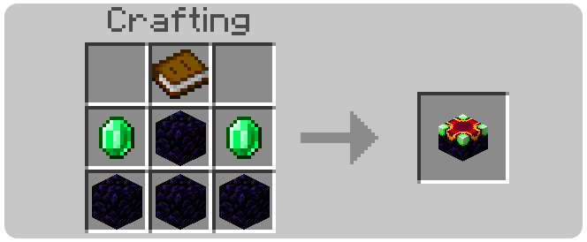

<p align="center">
  
</p>

# Enchant+ 1.1.0

An enchanting table for Minecraft: Bedrock Edition where you choose exactly which enchantments go on your
items. You can also remove enchantments and move them from one item to another. Version 1.1.0 is rebuilt for
**Minecraft Bedrock 1.26.50 and newer, targeting 1.26.52.3**. It uses only stable script modules, so no
experimental toggles are needed.

Original add-on by Death_Aruban ([DeathAruban/Enchant-MCBE](https://github.com/DeathAruban/Enchant-MCBE)).

## What it does

* **Add enchantments.** Pick an item, then choose the level of every enchantment it can take with sliders. You
  only pay for the levels you add. Treasure enchantments are included: Mending, Frost Walker, Soul Speed and
  Swift Sneak on leggings. The newer gear works too: maces (Density, Breach, Wind Burst), spears (Lunge) and
  copper tools and armour.
* **Remove enchantments.** Remove them all, or lower each one to the level you want to keep, and get part of
  the cost back.
* **Transfer enchantments.** Move levels from one item to another, for example from an enchanted book onto a
  sword. The menu lists anything the target cannot take, and why.
* **Books.** Enchant a plain book to make an enchanted book. An enchanted book that loses all its
  enchantments turns back into a book.
* **Worn gear.** Armour you are wearing and the item in your off hand show up in the menu. You don't need to
  take them off.
* Vanilla rules apply. Protection types exclude each other, and so do Sharpness, Smite and Bane of
  Arthropods, Silk Touch and Fortune, Infinity and Mending, and the other vanilla conflicts. No level goes
  above its vanilla maximum.

## Getting started

1. Craft **Enchant Essence**: an amethyst shard and lapis lazuli on the top row, and a glass bottle below
   the amethyst. You get six.
2. Craft the **Enchant+ Table**: Enchant Essence at the top, then emerald, obsidian, emerald, then obsidian,
   enchanting table, obsidian.

   <p align="center"></p>
3. Place the table. A glowing orb floats above it.
4. Use the table (right-click, or tap on touch screens) to open the menu. To place a block against the
   table instead, sneak.

## Prices

Prices are **per enchantment level**: per level added when enchanting, and per level moved when
transferring. These are the defaults:

| Currency | Per level | Refund when removing |
|---|---|---|
| XP levels | 3 | 50% |
| Enchant Essence | 3 | none |
| Scoreboard (off by default) | 10 | 60% |

For example, Sharpness V and Unbreaking III on a new sword is 8 levels: 24 XP levels and 24 Enchant Essence.
Players in Creative mode enchant for free.

All of this is set in `Enchant_Table_BP/scripts/config.js`. It also has switches for the framed menu window
(`themedForms`) and the orb (`orb`). After editing it, reload the world or run `/reload`.

## Installing

* **Windows, Android, iOS:** open `Enchant_Plus_v1.1.0.mcaddon`. Minecraft imports both packs. Then
  activate **Enchant+ [BP]** in your world's Behavior Packs. The resource pack is added with it.
* **Realms and dedicated servers:** upload both pack folders (`Enchant_Table_BP`, `Enchant_Table_RP`) and
  add them to the world.
* **Updating from 1.0.x:** the pack identities are the same. Activate 1.1.0 instead of the old version in
  your world. Tables you already placed keep working, and their orbs are re-centred automatically.

## For maintainers

The scripts are plain, readable JavaScript modules in `Enchant_Table_BP/scripts`:

| File | Purpose |
|---|---|
| `config.js` | Server-owner settings |
| `table.js` | The table block component (`da:enchant_table`) and the orb |
| `menu.js` | The menus: choose an item, enchant, remove, transfer |
| `rules.js`, `data.js` | Vanilla enchantment rules: which item takes what, conflicts, names, icons |
| `economy.js`, `inventory.js`, `ui.js` | Prices and payments, item slots, form and text helpers |

Every menu text is a lang key in `Enchant_Table_RP/texts/*.lang`. To translate the add-on, add a language
file there.

Checks and packaging need Node 20+ and Python 3.10+. The TypeScript type check uses the `@minecraft/server`
typings from the repository root (`npm install` there):

```sh
python3 tools/build.py --check --samples /path/to/bedrock-samples   # type check, tests, validator, then package
node tools/tests/test_enchant.mjs                                    # headless tests of every menu flow
python3 tools/validate.py --samples /path/to/bedrock-samples         # schemas and cross-references
```

`tools/tests` runs the real scripts against an in-memory mock of the Script API. `tools/validate.py`
checks the packs against Mojang's 1.26.50 JSON schemas from
[Mojang/bedrock-samples](https://github.com/Mojang/bedrock-samples). It also checks that every texture,
model, lang key, sound, recipe item and JSON UI reference resolves.

See [CHANGELOG.md](CHANGELOG.md) for what changed in 1.1.0.

## Credits

Original design, models and art: Death_Aruban. 1.1.0 update: rewritten scripts, UI and data for
Minecraft 1.26.5x.
